# Climate Organization Map: template

Start a climate organization map for your state or region: a network map of coalitions and the groups in them, a
geographic map, and lists of events, projects and actions. Point people keep their own group's information current
through Google Forms; your core team approves everything else. It's the code behind the
[MA Climate Organization Map](https://ma.climateorgmap.earth), with Massachusetts taken out.

Everything is free: the site runs on GitHub Pages, the data lives in your Google Sheet, and the forms are Google Forms
that the sheet builds for you. **You edit one file, [`map.config.ts`](map.config.ts).**

## Start your own map (about 15 minutes)

You need a GitHub account (not the one that owns this template: nobody can fork their own repo) and a Google account
that should own the map's sheet (ideally a shared team account: see [Who owns what](#who-owns-what)). Everything happens
in the browser. The drawings below are simplified; the numbered circles are the order to click in.

**Waiting:** about 5 minutes of the 15, at these points (⏳ in the steps):

| Wait | When | How long | How you know it's done |
|---|---|---|---|
| Site build | after steps 4 and 10 | about 2 minutes each | **Actions** tab: yellow dot = running, green ✓ = done |
| Your map's menu | step 8, after reloading the sheet | 5–10 seconds | a **Climate Organization Map** menu appears after **Help** |
| Setup script | step 8 | 1–3 minutes | a popup "Built and shared with the core team…" |
| A form submission | step 11 | about 1 minute | it shows on the map after a reload |

### On GitHub (about 4 minutes)

1. **Fork.** On this repo's page, click **Fork** (top right, between Watch and Star). Name it (e.g. `wi-climate-map`),
   leave **Copy the main branch only** ticked, click **Create fork**.

   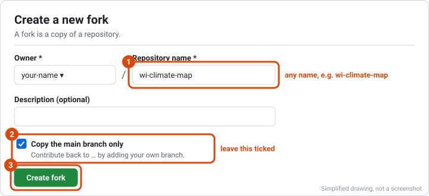

2. **Turn on Actions.** In your fork, click the **Actions** tab (the bar under the repo name) → **I understand my
   workflows, go ahead and enable them**.

   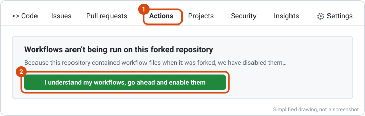

3. **Turn on Pages.** **Settings** (same bar, far right, gear icon) → **Pages** (left menu, under "Code and
   automation") → **Source**: choose **GitHub Actions**. It saves by itself.

   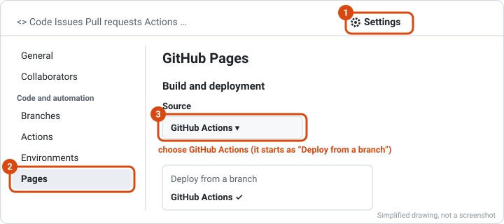

4. **Name your map.** Click the **Code** tab, then `map.config.ts` in the file list. Click the **pencil icon** at the top
   right of the file ("Edit this file").

   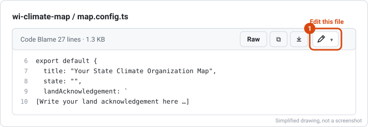

   Change `title` (e.g. `"WI Climate Organization Map"`) and `state` (e.g. `"WI"`), and replace the line
   `[Write your land acknowledgement here …]` with yours (keep the backticks around it). Then click **Commit changes…**
   (green, top right), choose **Commit directly to the main branch**, and click **Commit changes**.

   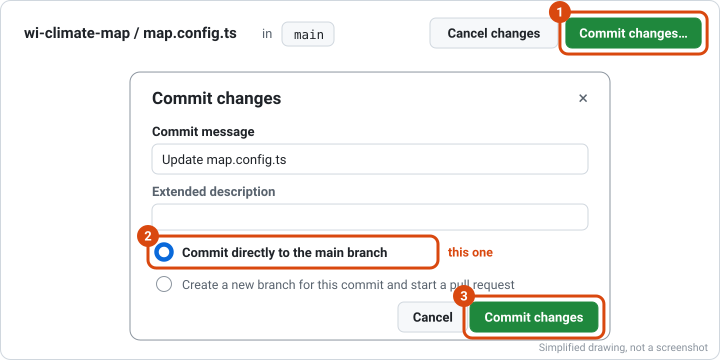

   ⏳ Your site now builds (about 2 minutes). Don't wait: go on with step 5.

### In Google (about 6 minutes)

5. **Make the sheet.** Open [sheets.new](https://sheets.new) (a blank Google Sheet) and name it: click "Untitled
   spreadsheet" at the top left, e.g. "WI Climate Organization Map data".
6. **Open your map's setup checklist:** `https://<your-github-name>.github.io/<repo-name>/setup.html`. Or: **Settings →
   Pages → Visit site** and click **Open the setup checklist** in the note on the map. (Not there yet? The build from
   step 4 is still running: wait for the green ✓ on the **Actions** tab.) Keep this page open: it checks each step.

   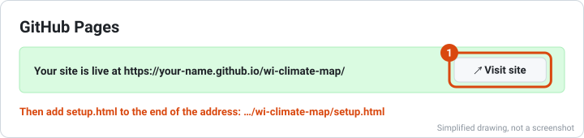

7. **Paste the sheet script.** On the checklist, click **Copy the sheet script**. In the sheet: **Extensions** (menu
   bar) → **Apps Script**; it opens in a new tab.

   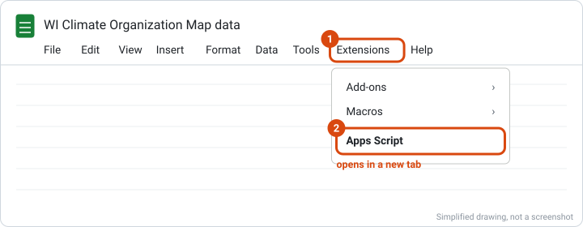

   Click inside the code, select all (Ctrl+A, Mac ⌘A), paste (Ctrl+V, Mac ⌘V), and click **Save** (the disk icon above
   the code). Leave this tab open for step 9.

   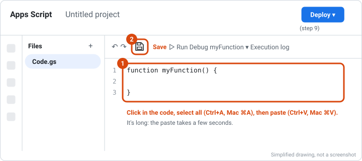

8. **Set up the sheet.** Go back to the sheet's tab and **reload it** (the browser's reload button). ⏳ After 5–10
   seconds a **Climate Organization Map** menu appears at the end of the menu bar. Click it → **Set up sheet + forms
   (run once)**.

   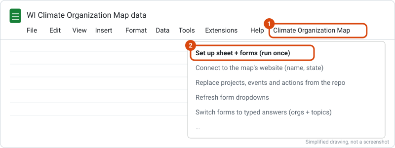

   Google asks for permission: **OK** → choose your account → "Google hasn't verified this app": **Advanced** → **Go
   to Untitled project (unsafe)** → tick **Select all** → **Continue**. (It's your own script; "unverified" only means
   Google hasn't reviewed it.) Tick **Select all**: without every permission, setup fails partway.

   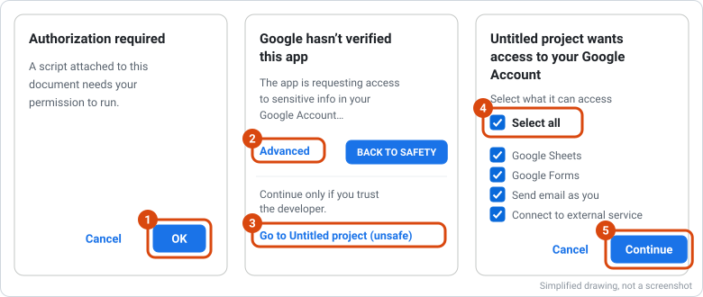

   If nothing happens after **Continue**, click **Set up sheet + forms** again. It then asks two things: your map's
   address (`https://<your-github-name>.github.io/<repo-name>/`, also shown at the top of the checklist) → **OK**; and
   your core team's emails, separated by commas (blank = just you) → **OK**.

   ⏳ **Then don't touch anything for 1–3 minutes.** The script works on its own: a "Running script" box shows at the
   top, and tabs and forms appear one by one. It's done when a popup says "Built and shared with the core team…": click
   **OK**.

9. **Publish the sheet's data.** In the **Apps Script** tab: **Deploy** (blue, top right) → **New deployment** → click
   the **gear** next to "Select type" → **Web app**. Set **Execute as: Me** and **Who has access: Anyone**, click
   **Deploy**. If it shows **Authorize access**, click it and allow everything as in step 8 (OK, Advanced, Go to …,
   Select all, Continue).

   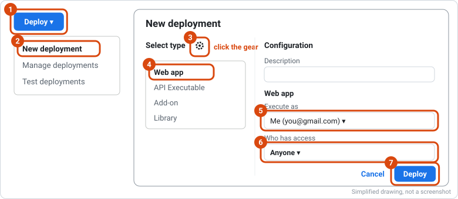

   Click **Copy** under **Web app URL** (it ends in `/exec`), then **Done**.

   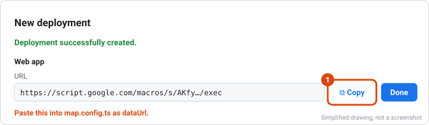

### Back on GitHub (about 1 minute)

10. **Connect the map to the sheet.** Edit `map.config.ts` again (pencil, as in step 4): paste the URL between the
    quotes of `dataUrl: ""`. **Commit changes…** → **Commit directly to the main branch** → **Commit changes**.
    ⏳ After the build (about 2 minutes), reload the checklist: every step is green.
11. **Try it.** Open your map, press **+**, and add your first group. ⏳ It shows on the map about a minute after you
    submit (reload the map). Delete test rows in the sheet when you're done.

That's it: approved form submissions show on the map within a minute, and a backup of the data is saved into the repo
every night.

### What `map.config.ts` sets

| Setting | What it's for |
|---|---|
| `title` | The map's name: page title, top bar, form titles, emails, the sheet's menu |
| `state` | Two-letter code. Fills in where the geographic map opens, the main city (where a group with no address yet is placed), the time zone and the state name |
| `landAcknowledgement` | Shown on the loading screen and under "Land acknowledgement" in the menu |
| `dataUrl` | The sheet's web app URL (step 9) |
| optional | `shortTitle`, `timeZone`, `bounds`, `fallback`, `exampleTowns`, `exampleOrgs`, `geo` (see [`src/map-config.ts`](src/map-config.ts)) |

The sheet reads the name and state from your site, and the site reads the forms from the sheet, so nothing else is
copied by hand.

## Get updates

1. On your fork's GitHub page: **Sync fork → Update branch**. The template never changes `map.config.ts`, your data or
   your logos, so this doesn't conflict. Don't edit the template's other files (this README included) in your copy.
2. Open your `setup.html`. If **Sheet script up to date** isn't green: copy the script again, paste it over `Code.gs`,
   **Save**, then **Deploy → Manage deployments → ✏️ → Version: New version → Deploy** (the URL stays the same), and
   run **Update the forms** from the sheet's menu.

## A climateorgmap.earth address

Maps can have an address like `wi.climateorgmap.earth`.

1. Ask first, through the [MA map's feedback form](https://docs.google.com/forms/d/e/1FAIpQLScwazw1P9rbQT4KAoUn0DSuI6B9Lpdx-kcrZXdZV45-HlAVKw/viewform):
   the address you'd like, your repo's link and who maintains it.
2. Once approved: **Settings → Pages → Custom domain**: `wi.climateorgmap.earth` → **Save** (before the DNS record
   exists, so nobody else can claim it).
3. The climateorgmap.earth team adds `CNAME wi → <your-github-name>.github.io`.
4. When the address works, tick **Enforce HTTPS** (can take up to a day). Then, in the sheet's menu, **Connect to the
   map's website** with the new address.

If a map shuts down, its DNS record is removed so the address can't be taken over.

## Who owns what

- The sheet's script and web app run as the Google account that set them up. If that account closes, the forms stop
  recording and the map stops updating. Use a shared team account, or write down who takes over.
- The fork belongs to whoever made it: add a second maintainer (**Settings → Collaborators**).
- Share the sheet only with your core team. Point people never open it: they use the forms. On the sheet's **Editors**
  tab, give each group's point person (up to three) the group's id.

## How it works

| Piece | What it does | Where it lives |
|---|---|---|
| The website | The map people look at. Never changes data itself. | Your fork, published by GitHub Pages (`.github/workflows/pages.yml`) |
| The Google Sheet | The source of truth: every coalition, group, event, project and action, and who may edit each. | Your Google Drive |
| Google Forms | How point people add and fix their group's information (Google sign-in; others wait in **Needs Review**). | Built by the sheet's script (`apps-script/Code.gs`) |

The sheet's web app publishes only public tabs (never Editors, Needs Review, Feedback or Change Log), plus the forms'
links. The site falls back to `public/data.json` (the nightly backup, `.github/workflows/sync-data.yml`) when Google is
unreachable. More on the sheet: [`apps-script/SETUP.md`](apps-script/SETUP.md).

## For the template's maintainers

- The MA map ([nkessel/openthink_mycc](https://github.com/nkessel/openthink_mycc)) is where the code is developed for
  now. To bring its changes in: `node scripts/sync-upstream.mjs`, check `npm run build && npm run test:apps-script`,
  push. It keeps the template's own files (`OWN` in the script): settings, empty data, notes.
- Never change a map's own files here (`map.config.ts`, `public/data.json`, `public/thoughts.json`, `public/logos/`,
  `src/logos.web.json`): every fork would get a conflict. New settings get a default in `src/map-config.ts` instead.
- Later the template can become the upstream for every map, MA included: the MA map then runs the same script the
  other way (`node scripts/sync-upstream.mjs <template url> main`) and moves its settings into `map.config.ts`.

## Run locally

```bash
npm install
npm run dev     # http://localhost:5173
npm run build   # typecheck + production build into dist/
npm run test:apps-script
```
